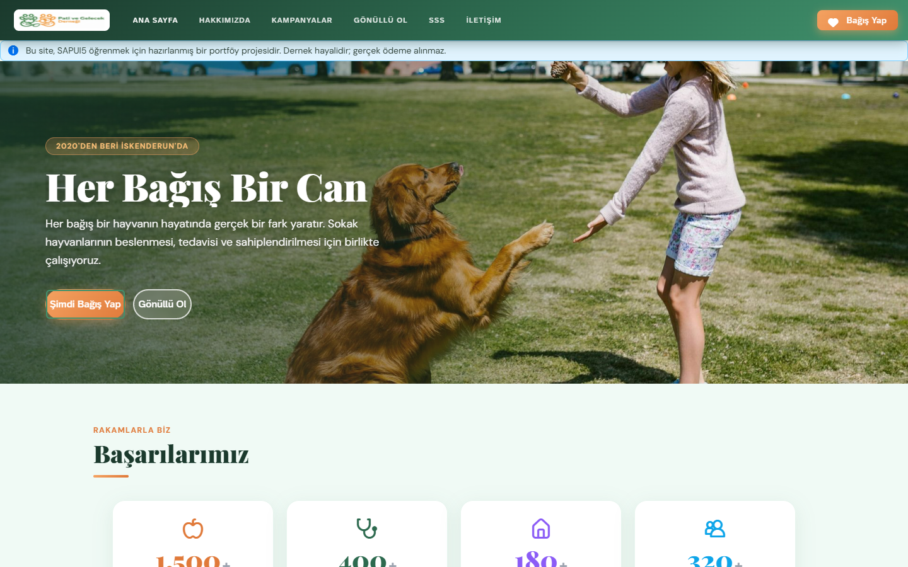
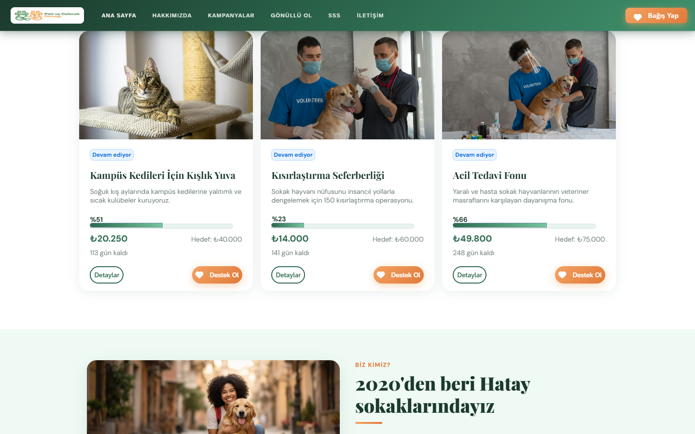
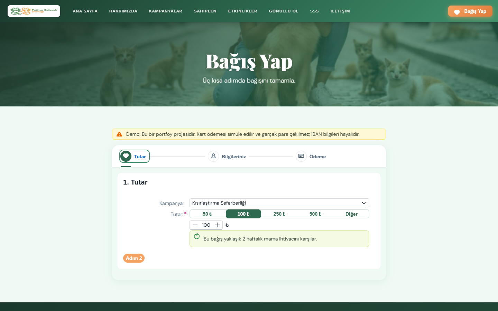
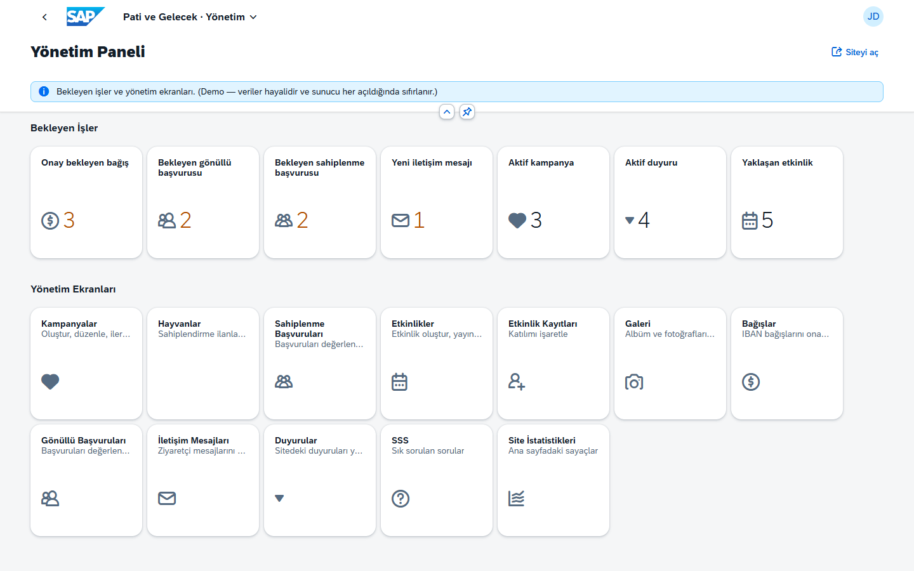
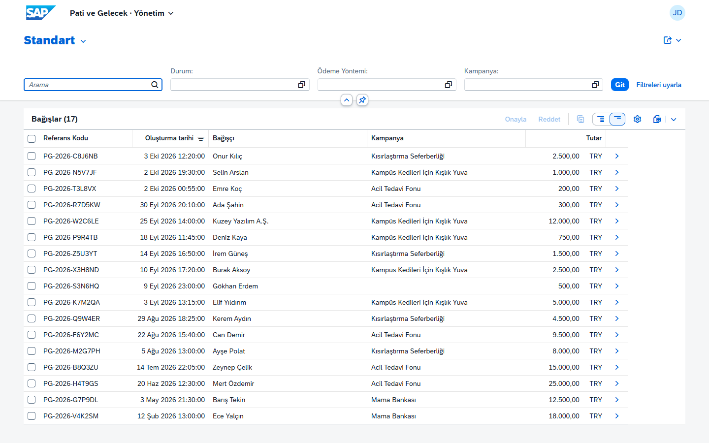

# 🐾 Pati ve Gelecek — SAPUI5 + SAP CAP Portföy Projesi

Hayali bir hayvan refahı derneği için hazırlanmış, **SAPUI5 öğrenmek amacıyla** geliştirilmiş uçtan uca bir web uygulaması.

- **Herkese açık site** — freestyle SAPUI5: kampanyalar, adım adım bağış sihirbazı, gönüllü başvurusu, iletişim formu
- **Yönetim paneli** — Fiori elements + Fiori Launchpad sandbox: bağış onayı, başvuru değerlendirme, mesajlar, içerik yönetimi
- **Backend** — SAP Cloud Application Programming Model (CAP) ile OData V4 servisleri

> ⚠️ **Demo projesidir.** Dernek, kişiler, IBAN ve tutarlar hayalidir. Gerçek ödeme alınmaz; e-postalar yalnızca sunucu konsoluna yazılır.



<table>
  <tr>
    <td></td>
    <td></td>
  </tr>
  <tr>
    <td></td>
    <td></td>
  </tr>
</table>

Diğer ekran görüntüleri: [docs/screenshots](docs/screenshots)

---

## Hızlı Başlangıç

**Gereksinim:** Node.js 22 veya üzeri. Veritabanı kurulumuna ya da hesap açmaya gerek yok.

```bash
git clone https://github.com/ZehraAltunok1/ISTE_DernekWebSite.git
cd ISTE_DernekWebSite
npm install
npm start
```

Ardından **http://localhost:4004** adresini açın.

| Uygulama | Adres | Giriş |
|---|---|---|
| Herkese açık site | http://localhost:4004/site/webapp/index.html | — |
| Yönetim paneli | http://localhost:4004/yonetim/webapp/index.html | `admin@example.com` / `admin123` |

Veriler bellekte tutulur: sunucu her yeniden başladığında demo verisine döner. Geliştirme sırasında `npm run watch` dosya değişikliklerinde sunucuyu otomatik yeniden başlatır.

---

## Neler Var?

### Herkese açık site (`app/site`)
| Sayfa | Öne çıkan UI5 konuları |
|---|---|
| Ana sayfa | OData V4 liste binding'i, ortak kart fragment'ı, `$top` ile sınırlı liste |
| Kampanyalar | Sunucu tarafı filtreleme (`SegmentedButton` → `binding.filter`) |
| Kampanya detayı | Element binding (`bindElement`), `$expand` ile son bağışlar, 404 yönetimi |
| Bağış | `sap.m.Wizard`, form doğrulama, **OData action** çağrısı, sonuç `Dialog`'u |
| Gönüllü ol | OData'dan beslenen `Select`, `SimpleForm`, sunucu hata mesajlarının gösterimi |
| İletişim | Ortak doğrulama modülü (`model/validation.js`), OData action |
| SSS | Gruplanmış liste (`sorter.group`), `Panel` |
| Hakkımızda, 404 | `sap.f.Card`, fotoğraf galerisi, `IllustratedMessage` |

Ortak yapı: `sap.tnt.ToolPage` + `NavContainer` + router, telefon menüsü (`ActionSheet`), i18n, formatter'lar, `BaseController`.
Tasarım: SAP tema değişkenleri (`--sap…`) ezilerek marka renkleri ve yazı tipleri (Playfair Display, DM Sans) uygulanır.

### Yönetim paneli (`app/yonetim`)
- **Fiori Launchpad sandbox** içinde çalışan bir Fiori elements V4 uygulaması
- **FPM dashboard**: bekleyen bağış, başvuru ve mesaj sayaçları ile modül kutucukları
- **7 modül** (List Report + Object Page): Kampanyalar, Bağışlar, Gönüllü Başvuruları, İletişim Mesajları, Duyurular, SSS, Site İstatistikleri
- Ekranların tamamı `annotations.cds`'teki annotation'lardan üretilir: filtre çubuğu, tablo sütunları, form grupları, açılır listeler, renkli durumlar, ilerleme göstergesi
- Onay / ret / "yanıtlandı" action'ları yalnızca uygun durumdaki kayıtlarda etkin (`Core.OperationAvailable`)
- Kampanya, duyuru, SSS ve istatistik düzenlemede **draft** (taslak) desteği

### Backend (`db/`, `srv/`)
- `SiteService` — herkese açık, salt okunur; ziyaretçi yalnızca `donate`, `applyVolunteer` ve `sendContactMessage` action'larını çağırabilir
- `AdminService` — `@requires: 'admin'`; durum değişiklikleri yalnızca action'larla
- Sunucu tarafı doğrulama ve Türkçe hata mesajları (`_i18n/messages.properties`)
- Anonim bağışçıların adı gizlenir; e-posta adresleri herkese açık servisten hiç verilmez

---

## Mimari

```
              SAP CAP (Node.js) — SQLite (bellek içi) — demo verisi: db/data/*.csv
                 │                                         │
          /odata/v4/site                            /odata/v4/admin
     (salt okunur + 3 action)                  (@requires: 'admin')
                 │                                         │
   app/site — Freestyle SAPUI5             app/yonetim — FLP sandbox
                                             ├─ FPM Dashboard
                                             └─ Fiori elements List Report / Object Page
```

| Katman | Teknoloji |
|---|---|
| UI | SAPUI5 1.148 (LTS, CDN), `sap_horizon` teması |
| Yönetim UI | Fiori elements for OData V4, Flexible Programming Model, Fiori Launchpad sandbox |
| Backend | SAP CAP 10, OData V4 |
| Veritabanı | SQLite (`@cap-js/sqlite`, bellek içi) |
| Test | Backend: `node:test` + `@cap-js/cds-test` · UI: QUnit + OPA5 (UI5 Test Starter), `ui5-test-runner` |
| Kalite | ESLint, UI5 Linter, GitHub Actions |

Ayrıntılı gereksinimler, kararlar ve yol haritası: **[PROJE.md](PROJE.md)**

---

## Komutlar

| Komut | Açıklama |
|---|---|
| `npm start` | Sunucuyu başlatır (http://localhost:4004) |
| `npm run watch` | Değişikliklerde otomatik yeniden başlatır |
| `npm test` | Backend testleri |
| `npm run test:ui` | QUnit + OPA5 testleri, başsız Chrome'da (önce `npm start`) |
| `npm run lint` | ESLint + UI5 Linter |
| `npm run screenshots` | README ekran görüntülerini yeniden üretir (önce `npm start`) |

UI testlerini tarayıcıda izlemek için: http://localhost:4004/site/webapp/test/testsuite.qunit.html

Her push'ta GitHub Actions lint'i, backend testlerini ve UI testlerini çalıştırır ([`.github/workflows/ci.yml`](.github/workflows/ci.yml)).

---

## Demo Hesapları

| Kullanıcı | Şifre | Rol |
|---|---|---|
| `admin@example.com` | `admin123` | Yönetici |
| `uye@example.com` | `uye123` | Üye (yönetim paneline erişemez) |

Bu hesaplar CAP'in geliştirme amaçlı *mocked* kimlik doğrulamasıyla çalışır ve `package.json` içinde tanımlıdır. CAP'in varsayılan şifresiz demo kullanıcıları güvenlik için kapatılmıştır.

---

## Lisans ve Görseller

Kod [MIT](LICENSE) lisanslıdır.

Fotoğraflar [Pexels](https://www.pexels.com/license/) ve [Unsplash](https://unsplash.com/license) lisanslı stok fotoğraflardır; iki görsel yapay zekâ ile üretilmiştir.
Fotoğrafçılar ve kaynak bağlantıları: **[docs/gorsel-kaynaklari.md](docs/gorsel-kaynaklari.md)**
